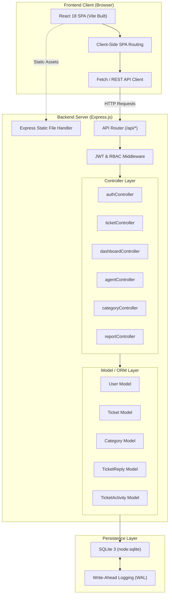
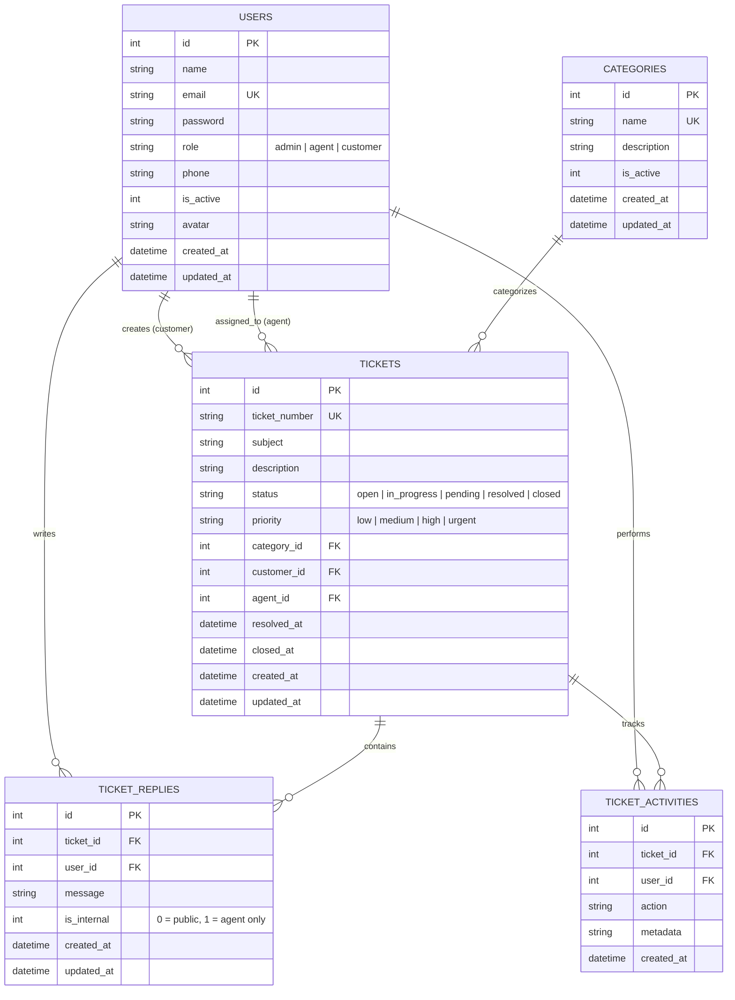

# 🎫 Online Ticket Support & Helpdesk Management System

[](https://nodejs.org/)
[](https://expressjs.com/)
[-003B57?logo=sqlite&logoColor=white)](https://www.sqlite.org/)
[-61DAFB?logo=react&logoColor=black)](https://react.dev/)
[](https://jwt.io/)
[](LICENSE)
[](https://support.akashshar.xyz)

> **Enterprise-Grade Helpdesk CRM & Customer Support Ticketing Platform**  
> Designed and engineered as a full-stack academic major project and production-ready portfolio application featuring **Role-Based Access Control (RBAC)**, real-time ticket lifecycle tracking, internal agent discussions, KPI analytics dashboards, and an immutable audit trail.

---

## 📑 Table of Contents

- [Executive Summary](#-executive-summary)
- [Key Features](#-key-features)
- [System Architecture](#-system-architecture)
- [Database Schema & ER Model](#-database-schema--er-model)
- [Role-Based Access Control (RBAC)](#-role-based-access-control-rbac)
- [Technology Stack](#-technology-stack)
- [RESTful API Reference](#-restful-api-reference)
- [Local Setup & Installation](#-local-setup--installation)
- [Demo Credentials](#-demo-credentials)
- [Production & cPanel Deployment](#-production--cpanel-deployment)
- [Testing & Quality Assurance](#-testing--quality-assurance)
- [Directory Structure](#-directory-structure)
- [Academic Project Details](#-academic-project-details)
- [Future Roadmap](#-future-roadmap)
- [Author & License](#-author--license)

---

## 🎯 Executive Summary

In enterprise environments, customer communication channels can easily become fragmented across disjointed emails, messaging apps, and phone calls. This results in missed inquiries, lack of accountability, and delayed resolutions.

The **Online Ticket Support Helpdesk System** resolves this challenge by providing an end-to-end ticketing platform that consolidates customer queries into organized, traceable, and priority-ranked support tickets. Built using an integrated full-stack architecture, it pairs an **Express.js** REST API with a high-performance **SQLite (WAL mode)** database and a compiled **React Single-Page Application (SPA)** frontend.

### Primary Objectives:
1. **Centralize Inquiries**: Eliminate dropped requests by assigning every customer query a unique tracked ticket identifier (`TKT-YYYY-XXXXX`).
2. **Multi-Tier Workflows**: Enable smooth collaboration between Administrators, Support Agents, and End-Users with strict access security.
3. **Operational Visibility**: Deliver real-time KPI metrics, category breakdowns, and workload distribution to optimize support agent utilization.
4. **Zero-Overhead Deployment**: Utilize Node.js native `DatabaseSync` (`node:sqlite`) with WAL mode to provide enterprise ACID transactional durability without requiring external database servers or native C++ compilation tools.

---

## ✨ Key Features

### 👑 Multi-Role Access Control (RBAC)
- **Administrator**: Complete administrative governance, customer and agent account management, category management, comprehensive KPI dashboards, SLA performance monitoring, and system-wide activity audit logs.
- **Support Agent**: Interactive support queue, ticket assignment/reassignment, priority escalation, status lifecycle transitions, customer public responses, and private internal notes.
- **Customer / Client**: Simple self-registration, ticket submission with priority & department classification, conversation thread timeline, and instant status monitoring.

### 🎫 Complete Ticket Lifecycle Management
- **Automated Ticket Numbering**: Unique format (`TKT-2026-00001`) generated atomically via database counters.
- **Status Lifecycle Workflow**:
  $$\text{Open} \longrightarrow \text{In Progress} \longrightarrow \text{Pending} \longrightarrow \text{Resolved} \longrightarrow \text{Closed}$$
- **Priority Matrix**: `Low`, `Medium`, `High`, and `Urgent` priority levels to govern Service Level Agreement (SLA) urgency.
- **Departmental Routing**: Tickets categorize into Technical Support, Billing & Payments, Feature Requests, Account & Access, and General Inquiry.

### 💬 Threaded Ticket Conversations & Private Notes
- **Public Replies**: Two-way communication between customers and assigned agents.
- **Internal Agent Notes (`is_internal: 1`)**: Hidden from customers; lets agents and managers consult internally directly on the ticket.

### 📊 Real-Time Analytics & KPI Dashboard
- Instant metrics on total, active, pending, and resolved tickets.
- Priority distribution charts and category frequency breakdown.
- Support agent workload distribution tracker to prevent burnout.
- Recent activity timeline showing real-time event logs.

### 📜 Security & Immutable Audit Logging
- Secure authentication using **JSON Web Tokens (JWT)** and **Bcrypt (cost factor 10)** password hashing.
- Complete audit logging in `ticket_activities` recording every status change, reassignment, reply, and ticket closure with exact timestamps.
- Parameterized SQL prepared statements to eliminate SQL Injection (SQLi) risks.

---

## 🏛️ System Architecture

The application adopts a clean **Model-View-Controller (MVC)** and service-oriented layered architecture:



---

## 🗄️ Database Schema & ER Model

The relational database is architected with strict foreign key constraints, automated cascades, and performance indices:



---

## 👥 Role-Based Access Control (RBAC)

| Capability / Action | Administrator | Support Agent | Customer |
| :--- | :---: | :---: | :---: |
| View System Dashboard & Global KPIs | ✅ | ⚠️ *(Scoped to Assigned)* | ⚠️ *(Scoped to Self)* |
| Submit New Support Tickets | ✅ | ✅ | ✅ |
| View All Tickets Across Departments | ✅ | ⚠️ *(Assigned + Open)* | ❌ *(Own Tickets Only)* |
| Change Ticket Status / Priority | ✅ | ✅ | ❌ |
| Reassign Agent on Tickets | ✅ | ✅ | ❌ |
| Post Public Reply to Ticket | ✅ | ✅ | ✅ |
| Post Private Internal Notes (`is_internal`) | ✅ | ✅ | ❌ |
| Manage Support Agents (CRUD) | ✅ | ❌ | ❌ |
| Manage Customer Accounts (CRUD) | ✅ | ❌ | ❌ |
| Manage Ticket Categories | ✅ | ❌ | ❌ |
| View SLA & Performance Reports | ✅ | ❌ | ❌ |
| Access Global Audit Logs | ✅ | ❌ | ❌ |

---

## 💻 Technology Stack

| Layer | Technology | Details |
| :--- | :--- | :--- |
| **Frontend Framework** | **React 18** | Modular component-driven Single Page Application (SPA) |
| **Bundler & Build Tool** | **Vite** | Modern, optimized production client bundling |
| **Styling & Design** | **Tailwind CSS & CSS Tokens** | Plus Jakarta Sans typography, clean modern SaaS layout |
| **Icons & Media** | **Lucide Icons & SVG** | Scalable, accessible iconography |
| **Runtime Environment**| **Node.js (v20+ / v22+)** | Non-blocking, asynchronous event-driven JavaScript runtime |
| **Backend Framework** | **Express.js (v4.21.2)** | Lightweight, robust web application framework |
| **Database Engine** | **SQLite3 (`node:sqlite`)** | Embedded database using Node.js native `DatabaseSync` |
| **Journaling & Locking**| **WAL Mode (Write-Ahead Log)** | Concurrent multi-reader and single-writer optimization |
| **Security & Auth** | **JWT & Bcrypt.js** | Stateless Bearer token auth and salted password hashing |
| **Environment Config** | **dotenv** | Strict separation of configuration and code |

---

## 🔌 RESTful API Reference

The backend exposes a well-structured RESTful API under the `/api` namespace:

### 1. Authentication Endpoints
| Method | Endpoint | Access | Description |
| :--- | :--- | :--- | :--- |
| `POST` | `/api/login` | Public | Authenticates user; returns JWT Bearer token |
| `POST` | `/api/register` | Public | Registers a new customer account |
| `POST` | `/api/logout` | Authenticated | Invalidates user session |
| `GET` | `/api/user` | Authenticated | Retrieves current authenticated profile & role |

### 2. Dashboard & Analytics
| Method | Endpoint | Access | Description |
| :--- | :--- | :--- | :--- |
| `GET` | `/api/dashboard` | Authenticated | Returns KPIs, status & priority counts, and workload |
| `GET` | `/api/reports` | Admin Only | SLA performance metrics, resolution timelines |
| `GET` | `/api/activity-logs`| Authenticated | Audit log stream of actions performed on tickets |

### 3. Ticket Management
| Method | Endpoint | Access | Description |
| :--- | :--- | :--- | :--- |
| `GET` | `/api/tickets` | Authenticated | Filterable ticket list (status, priority, search, category) |
| `POST` | `/api/tickets` | Authenticated | Create a new ticket (auto-generates ticket number) |
| `GET` | `/api/tickets/:id` | Authenticated | Detailed ticket view with conversation timeline & activity |
| `PUT` | `/api/tickets/:id` | Authenticated | Update ticket metadata (subject, description, category) |
| `DELETE` | `/api/tickets/:id` | Admin Only | Delete ticket and cascade associated records |
| `POST` | `/api/tickets/:id/replies` | Authenticated | Submit public reply in conversation thread |
| `POST` | `/api/tickets/:id/notes` | Agent / Admin | Submit internal private note (`is_internal = 1`) |
| `POST` | `/api/tickets/:id/assign` | Agent / Admin | Assign or reassign ticket to a support agent |
| `POST` | `/api/tickets/:id/status` | Agent / Admin | Update status (`open`, `in_progress`, `resolved`, etc.) |
| `POST` | `/api/tickets/:id/priority`| Agent / Admin | Escalate or reduce ticket priority |
| `POST` | `/api/tickets/:id/close` | Agent / Admin | Close ticket and register `closed_at` timestamp |
| `POST` | `/api/tickets/:id/reopen` | Authenticated | Re-open a resolved or closed ticket |

### 4. Categories, Agents & Customers
| Method | Endpoint | Access | Description |
| :--- | :--- | :--- | :--- |
| `GET` | `/api/categories` | Public | List all active support departments/categories |
| `POST` | `/api/categories` | Admin Only | Create new department category |
| `PUT` | `/api/categories/:id` | Admin Only | Edit category details |
| `DELETE` | `/api/categories/:id` | Admin Only | Deactivate or remove category |
| `GET` | `/api/agents` | Admin Only | List all support agents and their active ticket load |
| `POST` | `/api/agents` | Admin Only | Create new agent account with credentials |
| `GET` | `/api/customers` | Admin Only | List all registered customer accounts |

---

## 🚀 Local Setup & Installation

### Prerequisites
- **Node.js**: Version `20.x` or `22.x` installed ([Download Node.js](https://nodejs.org/))
- **Git**: Installed for version control

### 1. Clone the Repository
```bash
git clone https://github.com/dev-akashshar/support_akashshar.git
cd support_akashshar
```

### 2. Environment Configuration
Copy the sample environment file to create your local `.env`:
```bash
cp .env.example .env
```
Ensure your `.env` contains:
```env
PORT=8000
NODE_ENV=development
APP_URL=http://localhost:8000
CORS_ORIGIN=*
JWT_SECRET=super_secret_jwt_key_helpdesk_2026
DB_PATH=./src/database/database.sqlite
```

### 3. Install Dependencies
```bash
npm install
```
*(No C++ compilers or python build tools required — installs in seconds!)*

### 4. Initialize Database & Seed Sample Data
Execute the built-in database migration and seeder script:
```bash
npm run seed
```
This automatically:
- Creates all required database tables (`users`, `categories`, `tickets`, `ticket_replies`, `ticket_activities`).
- Configures indices and WAL mode.
- Seeds admin, agent, customer demo accounts, categories, and test tickets.

### 5. Launch Application
To start in development mode with automatic restart on file changes:
```bash
npm run dev
```
Or in standard mode:
```bash
npm start
```

Open your browser and navigate to:  
👉 **http://localhost:8000** (Full integrated application with frontend UI & API)

---

## 🔑 Demo Credentials

For quick evaluation during college presentations or viva testing, use these pre-configured accounts:

| Role | Email Address | Password | Privileges |
| :--- | :--- | :--- | :--- |
| 👑 **Administrator** | `admin@example.com` | `password` | Complete access to KPIs, settings, agents & users |
| 👑 **Admin (cPanel)** | `admin@helpdesk.com` | `password123` | Alternative admin credential for deployed instance |
| 🎧 **Support Agent** | `agent@example.com` | `password` | Queue handling, internal notes, status workflows |
| 🎧 **Agent (cPanel)** | `agent@helpdesk.com` | `password123` | Alternative agent credential for deployed instance |
| 👤 **Customer** | `customer@example.com`| `password` | Ticket creation, conversation threads, status checks |
| 👤 **Customer (cPanel)** | `customer@helpdesk.com` | `password123` | Alternative customer credential for deployed instance |

---

## 🌐 Production & cPanel Deployment

This project is optimized for deployment on standard Linux hosting environments and **cPanel Node.js Selector**:

### Step 1: Subdomain Setup in cPanel
1. Open cPanel ➔ **Domains** ➔ **Create A New Domain** / **Subdomains**.
2. Enter:
   - **Domain / Subdomain**: `support.akashshar.xyz`
   - **Document Root**: `public_html/support` (or `support.akashshar.xyz`)

### Step 2: Upload Files
1. In cPanel **File Manager**, navigate to the subdomain document root.
2. Upload the project archive or clone repository directly.
3. Extract files directly into the root so that `src/`, `public/`, `app.js`, and `package.json` are present.

### Step 3: Configure Node.js Application
1. In cPanel, click **Setup Node.js App** ➔ **Create Application**:
   - **Node.js version**: `20.x` or `22.x`
   - **Application mode**: `Production`
   - **Application root**: Path to your subdomain folder
   - **Application URL**: `support.akashshar.xyz`
   - **Application startup file**: `app.js`
2. Click **Create**.
3. Under detected configuration, click **Run NPM Install**.
4. Click **Start Application** or **Restart**.

The application is live at:  
👉 **https://support.akashshar.xyz**

---

## 🧪 Testing & Quality Assurance

The codebase includes an automated in-process test suite covering authentication, authorization, CRUD operations, and KPI calculations:

```bash
npm test
```
*or directly via Node:*
```bash
node src/test/run-in-process-test.js
```

### Verified Test Suite Scenarios:
- [x] Health check status (`/api/health`)
- [x] Public category retrieval (`/api/categories`)
- [x] Admin authentication and JWT token issuance (`/api/login`)
- [x] Profile resolution and role validation (`/api/user`)
- [x] Dashboard KPI calculation and distribution matrices (`/api/dashboard`)
- [x] Ticket creation with atomic counter sequencing
- [x] Status change and activity stream logging
- [x] Role validation preventing unauthorized route access

---

## 📁 Directory Structure

```text
support.akashshar.xyz/
├── .env.example               # Environment template configuration
├── .gitignore                 # Git ignore rules for dependencies & databases
├── package.json               # Node.js dependencies, scripts & metadata
├── app.js                     # Production entry point (for cPanel & PM2)
├── README.md                  # Comprehensive project documentation
├── README_CPANEL_SETUP.md     # cPanel deployment quick reference
│
├── public/                    # Built React Single Page Application (SPA)
│   ├── index.html             # Client HTML entry point
│   ├── favicon.svg            # Custom application favicon
│   ├── helpdesk_hero.png      # Hero showcase image
│   ├── helpdesk_register.png  # Registration showcase image
│   ├── logo.png               # Official Helpdesk branding logo
│   └── assets/                # Minified JavaScript & CSS bundles
│
└── src/                       # Backend Application Source Code
    ├── server.js              # Express application configuration & routing
    │
    ├── config/                # Core configurations
    │   └── db.js              # Native SQLite connection with WAL & sync settings
    │
    ├── database/              # Schema management & seed scripts
    │   ├── migrate.js         # Table schema definitions & index creation
    │   ├── seed.js            # Comprehensive sample data seeder
    │   └── database.sqlite    # SQLite database file (generated)
    │
    ├── controllers/           # HTTP Request Handlers (MVC)
    │   ├── authController.js        # Login, registration, token verification
    │   ├── ticketController.js      # Ticket lifecycle, replies, notes, assignments
    │   ├── dashboardController.js   # KPI computations & metric distributions
    │   ├── categoryController.js    # Department / Category CRUD
    │   ├── customerController.js    # Customer management
    │   ├── agentController.js       # Agent management & workload tracking
    │   ├── reportController.js      # Administrative reporting & statistics
    │   └── activityLogController.js # System activity audit trail
    │
    ├── middleware/            # Express Middlewares
    │   ├── auth.js            # JWT Bearer token validator
    │   ├── role.js            # Strict RBAC permission guard
    │   └── errorHandler.js    # Global error response standardizer
    │
    ├── models/                # Database Active Record / ORM Layer
    │   ├── Model.js           # Base database query builder & abstractions
    │   ├── User.js            # User entity and role scopes
    │   ├── Ticket.js          # Ticket entity and relation bindings
    │   ├── Category.js        # Category entity
    │   ├── TicketReply.js     # Reply entity (public / internal)
    │   └── TicketActivity.js  # Audit log entity
    │
    ├── routes/                # Modular Express Route Definitions
    │   ├── api.js             # API root aggregator
    │   ├── authRoutes.js      # Authentication endpoints
    │   ├── ticketRoutes.js    # Ticket lifecycle endpoints
    │   ├── dashboardRoutes.js # Dashboard metrics endpoints
    │   ├── agentRoutes.js     # Support agent endpoints
    │   ├── customerRoutes.js  # Customer endpoints
    │   ├── categoryRoutes.js  # Category endpoints
    │   ├── reportRoutes.js    # Reports endpoints
    │   └── activityLogRoutes.js# Activity log endpoints
    │
    ├── utils/                 # Helper Utilities
    │   ├── response.js        # Standardized JSON response formatters
    │   └── ticketNumber.js    # Atomic ticket numbering generator
    │
    └── test/                  # Test Suite
        ├── run-in-process-test.js # Test runner
        └── test-suite.js          # Automated end-to-end API tests
```

---

## 🎓 Academic Project Details

This project is prepared for formal academic submission as a Capstone / Final Year Software Engineering Major Project.

- **Project Title**: Online Ticket Support & Helpdesk Management System
- **Candidate / Developer**: **Akash Sharma** ([@dev-akashshar](https://github.com/dev-akashshar))
- **Live Production URL**: [https://support.akashshar.xyz](https://support.akashshar.xyz)
- **Repository**: [https://github.com/dev-akashshar/support_akashshar](https://github.com/dev-akashshar/support_akashshar)
- **Domain**: Web Application Development / Enterprise Software / Full-Stack Engineering

### Potential Viva & Technical Defense Discussion Points:
1. **Why SQLite over MySQL/PostgreSQL for this architecture?**
   - *Defense*: Node.js 22 provides built-in `node:sqlite` via `DatabaseSync`. Combined with `PRAGMA journal_mode = WAL` (Write-Ahead Logging), it delivers sub-millisecond query responses, zero external server overhead, zero network round-trip latency, and zero dependency on native C++ compilation (unlike `better-sqlite3` or MySQL drivers).
2. **How does the system ensure data isolation between tenants/roles?**
   - *Defense*: All queries in `dashboardController` and `ticketController` enforce programmatic scoping:
     - Customers can only query where `customer_id = req.user.id`.
     - Agents are scoped to assigned tickets or open pools.
     - Admins retain unrestricted global visibility.
3. **How are internal notes kept confidential from customers?**
   - *Defense*: The `ticket_replies` table maintains an `is_internal` boolean flag. In `ticketController.show`, rows marked `is_internal = 1` are stripped from the response payload whenever `req.user.role === 'customer'`.

---

## 🔮 Future Roadmap

- [ ] **Email Notification Service**: Automated dispatch of confirmation emails and updates using Nodemailer and SMTP.
- [ ] **Real-Time WebSockets**: Instant conversation updates and typing indicators via Socket.io.
- [ ] **SLA Escalation Engine**: Automated escalation rules when high/urgent tickets remain unaddressed beyond predefined time limits.
- [ ] **File Attachments**: Direct document, screenshot, and PDF uploads stored in S3/Cloud Storage.
- [ ] **AI Support Assistant**: Integration with LLM APIs for automated ticket categorization, sentiment analysis, and smart response suggestions.

---

## 📄 Author & License

- **Developer**: [Akash Sharma](https://github.com/dev-akashshar)
- **License**: Released under the [ISC License](LICENSE). Suitable for educational, commercial, and open-source usage.

---
⭐ *If this project helped your learning or software evaluation, feel free to give it a star on [GitHub](https://github.com/dev-akashshar/support_akashshar)!*
